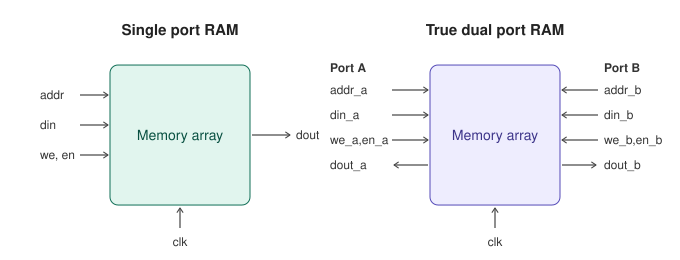
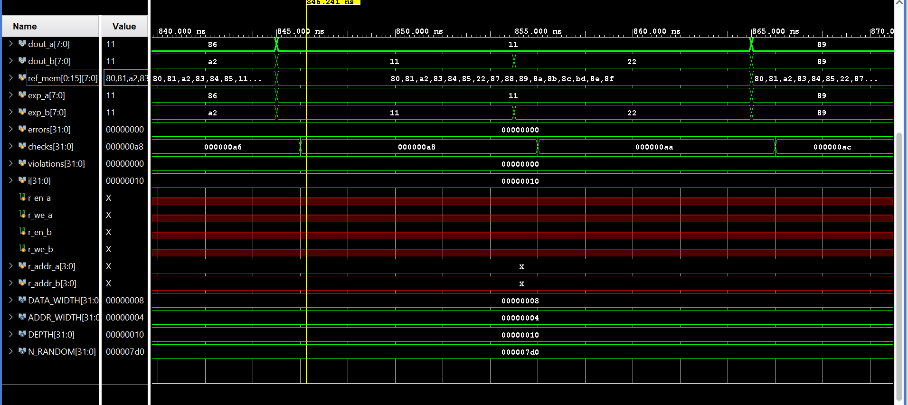
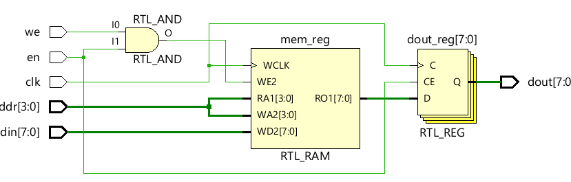
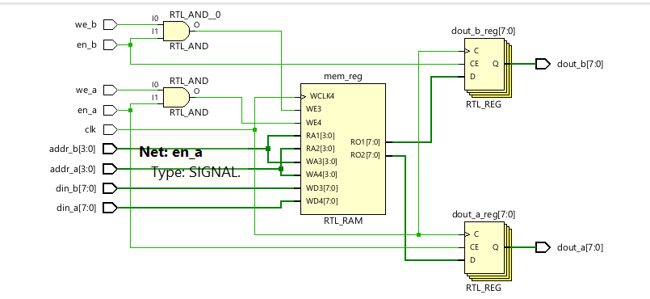
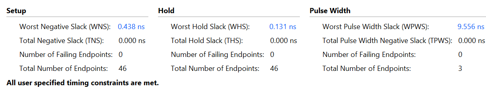

# Single Port and True Dual Port RAM in Verilog

Parameterized single port and true dual port RAMs, written in Verilog, verified with self-checking testbenches and taken through synthesis, implementation and static timing analysis in Xilinx Vivado for an Artix-7 FPGA (`xc7a35tcpg236-1`).



## Highlights

- Synchronous, **read-first** RAMs with 1-cycle read latency, parameterized width and depth
- **Self-checking testbenches** with a reference model: 1043 checks (single port) and 4184 checks (dual port), 0 errors
- **Collision behaviour defined and verified** for the dual port RAM, plus a protocol checker for illegal same-address double writes
- **Bug-injection runs** prove the testbenches detect real faults
- Compared **distributed RAM vs block RAM** mapping in synthesis
- **Timing closure analysis**: found and root-caused a −2.06 ns violation in the dual port RAM and determined its Fmax (~83 MHz)

## Repository structure

```
verilog-ram/
├── rtl/
│   ├── single_port_ram.v
│   └── dual_port_ram.v
├── tb/
│   ├── tb_single_port_ram.v
│   └── tb_dual_port_ram.v
├── constraints/
│   └── ram_timing.xdc
└── docs/                 block diagram, schematics, waveforms, reports
```

## Design specification

| Item | Single port | Dual port |
|---|---|---|
| Data width | 8 bits (`DATA_WIDTH`) | 8 bits (`DATA_WIDTH`) |
| Depth | 16 words (`ADDR_WIDTH = 4`) | 16 words (`ADDR_WIDTH = 4`) |
| Ports | 1 read/write port | 2 independent read/write ports (A, B), shared memory |
| Write | Synchronous, when `en = 1` and `we = 1` | Same, per port |
| Read | Synchronous, 1-cycle latency | Same, per port |
| Read during write | Read-first (old data on `dout`) | Read-first on both ports |
| `en = 0` | No access, `dout` holds its value | Same, per port |
| Clock | Single clock | Single clock shared by both ports |

### Dual port collision rules (same address, same cycle)

| Port A | Port B | Result |
|---|---|---|
| Read | Read | Both get the stored data |
| Write | Read | B gets the **old** data (read-first) |
| Read | Write | A gets the **old** data (read-first) |
| Write | Write | **Not allowed:** stored value undefined. Flagged by the testbench protocol checker |

## Verification

Both testbenches are self-checking. They do not depend on looking at waveforms:

- A **reference model** (`ref_mem`) mirrors the memory. Every cycle it computes the expected `dout` (reads first, then applies writes) and compares it with the DUT output using `!==`, so X values are caught too.
- Inputs are driven on the **falling edge** so they are stable at the rising edge (no race conditions).
- An automatic **PASS/FAIL summary** is printed at the end.

**Single port tests:** write all addresses, read back all addresses, read-first check, enable-low check (no write, output holds), first/last address, 1000 random operations.

**Dual port tests:** write through A and read through B, write through B and read through A, simultaneous write A / read B at different addresses, simultaneous writes to different addresses, collision A-write / B-read, collision B-write / A-read, both ports reading the same address, one port disabled, 2000 random cycles with about 25% forced same-address accesses. A **protocol checker** reports any cycle where both ports write the same address.

### Results (Vivado XSim)

| Testbench | Checks | Errors | Protocol violations | Result |
|---|---|---|---|---|
| `tb_single_port_ram` | 1043 | 0 | n/a | PASSED |
| `tb_dual_port_ram` | 4184 | 0 | 0 | PASSED |

### Bug-injection check (does the testbench actually catch bugs?)

| Injected bug | Errors reported |
|---|---|
| Single port changed to write-first | 526 |
| Dual port, port B changed to write-first | 899 |
| Dual port, port B ignores `en_b` | 524 |

### Waveforms

Collision test (TEST 5): port A writes `22` to address 6 while port B reads it. Port B returns the old value `11`, then `22` on the next read.



Single port read-first test (TEST 3):


## Synthesis results (Artix-7 xc7a35tcpg236-1)

| Design | Slice LUTs | Flip-flops | Block RAM | I/O |
|---|---|---|---|---|
| Single port, default | 9 (8 as memory + 1 logic) | 8 | 0 | 23 |
| Single port, `(* ram_style = "block" *)` | 0 | 0 | 0.5 (RAMB18) | 23 |
| Dual port, `(* ram_style = "block" *)` | 0 | 0 | 0.5 (RAMB18) | 45 |

- A 16 × 8 RAM is only 128 bits, so by default Vivado maps it to **distributed (LUT) RAM**: one LUT per data bit, one LUT for the `we AND en` logic, and 8 flip-flops for the output register.
- Forcing block RAM moves the enable, write enable and output register **inside the RAMB18**, so no LUTs or flip-flops are used.
- The true dual port RAM needs block RAM: distributed RAM on 7-series supports only one write port, and here both ports can write.




## Timing analysis

I/O delays are constrained to 0 ns, so the reports measure only the delay inside the FPGA (see `constraints/ram_timing.xdc`).

| Design | Clock | WNS | TNS | WHS | Status |
|---|---|---|---|---|---|
| Single port (distributed) | 100 MHz | +0.346 ns | 0 | +0.096 ns | Met |
| Dual port (block RAM) | 100 MHz | **−2.059 ns** | −30.871 ns | +0.131 ns | **Failed** (16 endpoints) |
| Dual port (block RAM) | 80 MHz | +0.438 ns | 0 | +0.131 ns | Met |

### Why the dual port RAM failed at 100 MHz

The 16 failing endpoints are all `dout_a` and `dout_b` output pins. Worst path, block RAM to `dout_a[0]`:

| Path segment | Delay |
|---|---|
| Clock: `clk` pin → IBUF → BUFG → RAMB18 | 4.61 ns |
| RAMB18 clock-to-output | 2.45 ns |
| Routing to the output pin | 2.36 ns |
| OBUF to pin | 2.60 ns |
| **Arrival** | **12.02 ns** (required 9.97 ns) |

In the single port design, the worst path starts at a fabric flip-flop (`dout_reg` → `dout` pin), whose clock-to-output is much faster than the block RAM's. That difference is the ~2 ns gap. The required period is about 12.06 ns, so **Fmax ≈ 83 MHz** with unregistered outputs driving pins directly. This was confirmed by meeting timing at 80 MHz.

Most of the path is I/O: clock insertion delay plus output buffer. Inside a larger design, the RAM output would feed internal logic and the limit would be much higher.



## Key learnings

- Writing a spec first (latency, read-during-write, collision rules) makes verification straightforward
- A reference-model scoreboard plus bug injection gives real confidence in a testbench
- Small memories map to LUT RAM; large or true dual port memories need block RAM
- Block RAM outputs are slow compared to flip-flops, which is why real designs usually register them
- Reading a timing report: separating clock delay, cell delay and routing delay to find the real cause of a violation

## How to run

### Vivado

1. Create an RTL project for part `xc7a35tcpg236-1`.
2. Add `rtl/*.v` as design sources, `tb/*.v` as simulation sources and `constraints/ram_timing.xdc` as constraints.
3. Set the testbench as top for simulation, run **Behavioral Simulation**, then **Run All**. The Tcl console prints `RESULT : TEST PASSED`.
4. Set the RAM as top for synthesis, then **Run Synthesis** → **Run Implementation** → **Report Timing Summary**.

### Icarus Verilog

```bash
iverilog -g2005 -o sp rtl/single_port_ram.v tb/tb_single_port_ram.v && vvp sp
iverilog -g2005 -o dp rtl/dual_port_ram.v tb/tb_dual_port_ram.v && vvp dp
```

## Future work

- Add a registered output stage (2-cycle read latency) and compare timing
- Separate clocks per port (asynchronous true dual port RAM)
- Rewrite the testbench in SystemVerilog with assertions and functional coverage

## Tools

Xilinx Vivado (synthesis, implementation, XSim), Icarus Verilog
